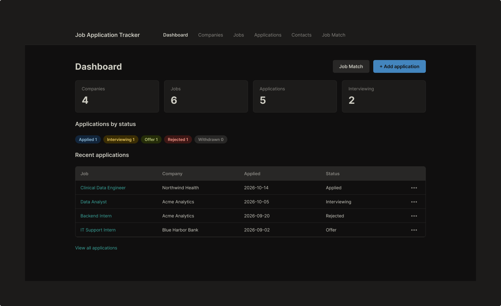

# COP-4751: Job Application Tracker: `jot`

A web application project for COP-4751 at FIU. Built to help track job
applications during the job search process.

## Stack

- [MySQL](https://dev.mysql.com/doc/) Database
- Python with [Flask](https://flask.palletsprojects.com/en/stable/)
- HTML/CSS for the web interface

## Getting Started

First, copy `.env.example` to `.env`, and modify the values as necessary for the
connection. Then install dependencies:

### With `uv` (recommended)

```bash
uv sync
uv run --env-file .env flask --app jot.app run --debug
```

### With standard `pip`

```bash
# unix
python3 -m venv .venv
source .venv/bin/activate
pip install -r requirements.txt
pip install --no-build-isolation --no-deps -e .

# windows
py -m venv .venv
.venv\Scripts\activate
pip install -r requirements.txt
pip install --no-build-isolation --no-deps -e .
```

And run the project (in that same virtual environment) with:

```bash
flask --app jot.app run --debug
```

> **Note:** If you modify dependencies in `pyproject.toml`, re-export `requirements.txt` with:
>
> ```bash
> uv export --no-dev --no-hashes -o requirements.txt
> ```

### Docker

A Docker compose setup is included which runs the Flask application and MySQL
with the `job_tracker` database created. Run it with:

```bash
docker compose up -d
```

And then visit [localhost:5000](http://localhost:5000)

The scripts in `sql/` only run on a fresh volume: the schema, then sample data
from `02_seed.sql`. To start over with a clean seed, remove the volume with
`docker compose down -v`.

### SQL Linting

SQL is linted and formatted with [sqlfluff](https://docs.sqlfluff.com/), which
is configured in `.sqlfluff`:

```bash
sqlfluff lint sql
sqlfluff format sql
```

## Architecture

### Structure

```
├── README.md
├── AGENTS.md
├── AI_USAGE.md                    # Project AI usage trace
├── requirements.txt               # Project dependencies
├── .env                           # Configure database environment variables
├── .sqlfluff                      # SQL lint and format configuration
├── docker-compose.yml             # Containerized database and Flask app
├── Dockerfile                     # Containerized database and Flask app
├── tests                          # Test: validation & models, CRUD, matching
├── sql                            # Applied in order by Docker compose on first start
│   ├── 01_schema.sql              # Base schema
│   └── 02_seed.sql                # Sample data for UI development and tests
└── src
    └── jot
        ├── app.py                 # Core setup
        ├── db.py                  # Connection configuration
        ├── models                 # Core types and validation
        ├── repositories           # CRUD operations
        ├── routes                 # Routes: templates loaded for requests and routing
        ├── services               # Logic not tied to SQL or HTTP (matching)
        ├── static                 # CSS Styling
        └── templates              # Components, pages, errors
```

With this setup, the request flow breaks down to:

1. `routes/` parses the request on the client
2. The request is then validated with `models/`
3. Once validated, it calls out to `repositories/` or `services/`
   - Based on if it is a CRUD operation or part of our matching algorithm
4. The route then renders the appropriate template from `templates/`

### Design

Some core ideas here:

- Since we don't have a user table, we can model the matching to be an algorithm
  that runs off the url's query params.
  - `GET /match/?skills=Python,SQL` scores each job by the share of its
    `requirements` those skills cover (`services/match.py`). Matching ignores
    case and whitespace, and a repeated skill counts once. Jobs with no
    requirements, or with no matching skill, are left out.
- Models define and validate our schema for our application
- Repositories and services do DB and business logic
- Templates exist for components and pages, which use classes reflected in CSS
- There is a clean separation of concern among the described flow

### Frontend

Added Figma exports for some of the pages in `./assets/figma`, for example, the
original dashboard design:


